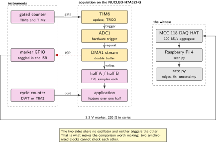
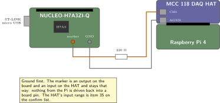
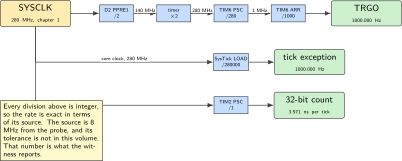
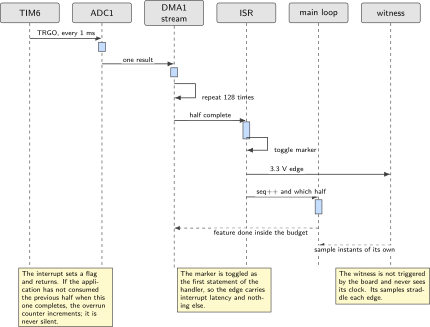
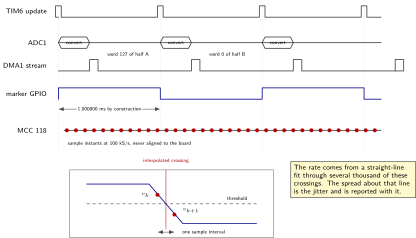

# Chapter 6. Sampling on a timer at exactly 1 kHz

> **Target board:** NUCLEO-H7A3ZI-Q with an MCC 118 on a Raspberry Pi  
> **Theme:** Timer-triggered acquisition, proving the rate externally

> **Key facts**
>
> - **Board:** NUCLEO-H7A3ZI-Q, plus a Raspberry Pi 4 carrying an MCC 118 DAQ HAT as the external witness
> - **Peripherals:** TIM3 as the trigger and, through its channel 1, as the driver of the marker pin itself, ADC1 with hardware trigger, DMA in double-buffer mode, TIM2 and TIM5 as instruments, one free GPIO as the marker
> - **Toolchain:** arm-none-eabi-gcc with CMake as in chapter 1; Python 3 with the HAT library on the Pi
> - **Operating system:** Bare metal on the board, Raspberry Pi OS on the witness
> - **Difficulty:** 4 of 5
> - **Effort:** 4 evenings of about four hours, one of them entirely on the Pi
> - **Deliverable:** Three sampling builds that share one application, an external measurement that states the sample rate with an uncertainty, and the two instruments the rest of this book measures with

## Why this project

Every chapter after this one makes a claim about time. Chapter 7 claims a wake takes so many milliseconds, chapter 10 splits a duty cycle into phases, chapter 18 counts cycles per transform and chapter 20 reports a latency distribution. None of those claims mean anything until there is an instrument, and this bench has no oscilloscope and no logic analyser. So this chapter does two jobs at once. It builds a sampling front end that acquires at a fixed rate while the processor is busy elsewhere, and it builds the instruments: a cycle counter wrapper with a fallback, and a gated frequency counter that can be pointed at any periodic signal on the board.

The second job is the reason the chapter is worth four evenings rather than one. A sample rate that is configured is not a sample rate that is proven. The usual practice is to write the prescaler and the reload value, do the arithmetic, and call the result 1 kHz. That arithmetic is worth doing and this chapter does it, but it establishes only that the divider chain is exact. It says nothing about the oscillator the chain divides, nothing about whether the interrupt actually fires when the timer says it does, and nothing about jitter. The only honest way to settle those is to put a second, independent clock next to the first and compare them. The MCC 118 on a Raspberry Pi is that second clock: it samples a pin the board toggles from its own sampling interrupt, at a rate high enough that each edge lands between two known instants.

The third reason is structural. A sampling loop that does its work inside the interrupt looks correct at 1 kHz and fails silently at 10 kHz, because the overrun has nowhere to be reported. Decoupling acquisition from processing is the pattern the rest of Part I and all of Part II depend on, and this chapter builds it three ways and measures the difference.

> [!NOTE]
> **This part is not the STM32H7 the internet is about**
>
> The timer inventory, the transfer request numbers that connect the converter to a transfer stream, and the rule about which transfer engine reaches which memory all differ between RM0455, which documents this part, and RM0433, which documents its better-known sibling. The prior art named below was written on a Cortex-M7 Nucleo of the other kind. Its structure transfers; its request numbers do not. Read them out of RM0455's request table for this part, not out of a working project for another one.

## Prior art and what to reuse

| Source | What it gives | What it does not | Licence |
| --- | --- | --- | --- |
| Ian Ross's five-step progression on a Cortex-M7 Nucleo | Exactly this chapter's shape: the same acquisition solved in rising order of sophistication, with a written series explaining each step's reason | It is small, unmaintained, and written for a different member of this family. No double buffering, no external verification, no instrument | MIT |
| The vendor's basic examples for this board | Working register settings for a timer trigger into the converter, in a tree that also solves the same job polled and on interrupt | Its example projects sit under a licence tied to this vendor's silicon; only the basic examples are permissive. No verification of the resulting rate | BSD-3-Clause for the basic examples |
| Majerle's transfer-driven serial work | The half-transfer and transfer-complete pattern this chapter reuses for the converter, proven across eight families | It is a serial receive problem, not acquisition, and it does no cache maintenance | MIT |
| GorgonMeducer's performance counter | A cycle-accounting library that deliberately runs on the system tick rather than the core's trace counter, because the tick is universally present | It is a whole library where this chapter needs a twenty-line wrapper with a self-test | Apache-2.0 |
| The HAT library for the acquisition board | A Python interface to the external witness with a scan API and published examples | Its licence is not recorded in this volume's prior-art pool. Read the repository's licence file before vendoring any of it. This chapter only calls it | Read before use |

*Table 6.1. Prior art for chapter 6. The five-step progression is the closest thing to this chapter that exists, and its written series is worth reading before you start; the part it is written for is not this one.*

What is left to write is the verification and the instruments. No source in the pool measures the rate it configures. The external witness method below, the edge-interpolation arithmetic that turns a sampled square wave into a rate with an uncertainty, the cycle counter wrapper with a runtime self-test and a timer fallback, and the gated counter and its reciprocal upgrade are all the author's work, and they are the reason this chapter comes before the seven that cite it.

## Parts from the inventory

| Part | Role | Interface |
| --- | --- | --- |
| NUCLEO-H7A3ZI-Q | The subject. Samples on a timer and toggles a marker pin from the sampling interrupt | Micro USB to the host |
| Raspberry Pi 4 | The witness. Runs the scan and the analysis | Ethernet or wireless to the host |
| MCC 118 DAQ HAT | The calibrated reference, 8 channels, 12-bit, 100 kS/s aggregate | 40-pin header on the Pi, screw terminals to the board |
| Two jumper wires | Marker pin and a common ground reference | Screw terminal at one end, Zio header at the other |
| A 220 Ω resistor | In series with the marker pin, so a wiring error costs nothing | Breadboard |

*Table 6.2. Inventory items used in chapter 6. Nothing is bought and nothing is soldered. Whether male-to-male jumper wires exist in the drawer is item 36 on the confirm list; the screw terminals on the HAT accept a bare wire end either way.*

## System architecture



*Figure 6.1. Two independent clocks, one signal between them. The board's divider chain produces the sample instants; the witness has its own oscillator and never sees the board's. What the comparison proves is agreement, which is a stronger and more modest claim than accuracy.*

The board's side is a chain with no software in it: a timer reaches its reload value, emits a trigger event, the converter starts on that event, and the transfer engine moves the result to memory. The processor is told only when a half of the buffer is complete, and between those notifications it is free. The witness is deliberately dumb: it samples one channel continuously at a high rate, writes the samples to a file with a start timestamp, and the analysis happens afterwards on the same Pi. Nothing on it is synchronised to the board, which is the point.

## Peripheral configuration

| Peripheral | Mode | Clock source | Pins and function | Interrupt and transfers |
| --- | --- | --- | --- | --- |
| TIM3 | Up counter, update event on TRGO, channel 1 in toggle output-compare | APB1 timer clock | PB4 as TIM3_CH1 on alternate function 2, which is the marker | No interrupt in any of the three builds |
| ADC1 | Single channel, hardware trigger on the timer's TRGO | ADC kernel clock, confirm the source in RM0455 | One analogue input, channel confirmed in the datasheet | Transfer request to a DMA stream |
| DMA1 stream | Double buffer, two memory pointers | Bus clock | None | Half and full transfer interrupts |
| GPIO marker | Alternate function 2 in the two timer-triggered builds, so the timer drives the pin and no software is in the path; a push-pull output toggled in the tick exception in the tick build, where the processor is in the path by design | Peripheral bus | PB4, item 13 on the confirm list, reached at Morpho CN12 pin 27 when a shield covers the Zio position | None |
| TIM2 | Free running 32-bit, or input capture for the reciprocal counter | APB1 timer clock | Capture pin from the alternate-function table | Capture interrupt, reciprocal build only |
| TIM5 and TIM7 | External clock mode 2 counting edges, and an up counter as the gate | The signal under test, and the APB1 timer clock | External trigger pin from the alternate-function table | Gate interrupt only |
| SysTick | 1 kHz reload, the simplest build | Core clock | None | SysTick exception |

*Table 6.3. Peripheral configuration. Two 32-bit timers exist on this part and both are spent on instruments rather than on the application, which is a deliberate allocation and is worth stating in the repository README.*

## Wiring



*Figure 6.2. One signal wire and one ground wire. The series resistor is not protection for the board, which drives the pin, but insurance against the wire finding the wrong terminal.*

Two safety points before the wires go in. The board's logic is 3.3 V and nothing from the Pi or the HAT may be driven back into a board pin; the marker is an output on the board and an input on the HAT, and it stays that way. The grounds must be common or the witness measures an undefined potential, so the ground wire is not optional and goes in first. The HAT's input range and whether it offers an external trigger are item 35 on the confirm list: read the HAT's user guide before assuming a 3.3 V swing is comfortably inside the range, even though every range this HAT is likely to offer contains it.

## Memory and timing budget



*Figure 6.3. Where 1 kHz actually comes from. The divider chain is exact, and that is a different claim from accurate. Everything to the left of the timer is inherited from chapter 1's clock configuration and its accuracy is the probe's.*

The arithmetic is worth writing out because it is the part that is exact. With the peripheral bus prescaler set so the timer kernel clock is 280 MHz, a prescaler value of 279 divides by 280 and gives a 1 MHz counter. A reload value of 999 counts 1000 of those and gives an update event every millisecond. Both divisions are integer, so there is no residue and no slow drift from rounding. The same is true of the tick: a reload of 279999 on a 280 MHz core clock is exactly one millisecond and fits in the tick's 24 bits with room to spare.

What is not exact is the 8 MHz the whole chain starts from, which comes from the probe and carries the probe's tolerance. That number is not in this volume and is not guessed at here. It is what the external measurement below reports.

| Quantity | Budget | Measured | Margin |
| --- | --- | --- | --- |
| Sample period | 1.000000 ms by construction | not measured | not measured |
| Interrupt to marker edge | under 2 µs | not measured | not measured |
| Edge to edge jitter | under 1 µs peak | not measured | not measured |
| Cycles in the sampling interrupt | under 2000 of 280000 | not measured | not measured |
| Buffer, 128 samples per half | 512 B in a region the stream can reach | 512 B by construction | none needed |
| Processing budget per half | 128 ms | not measured | not measured |

*Table 6.4. The budget for chapter 6. Every measured cell is filled by the end of the chapter, by the witness for the first three rows and by this chapter's own cycle counter for the fourth. Nothing is filled by arithmetic.*

## Firmware design (UML)



*Figure 6.4. One half of the buffer filling, with nothing to do in the interrupt but set a flag. The processing runs on the half that is no longer being written, which is what makes the block size a budget rather than a deadline.*

The design has one invariant and it is worth stating before the code. At any instant the transfer engine is writing one half of the buffer and the application may read the other. The interrupt's only job is to record which half just became readable, and the only failure mode is that the application has not finished with a half by the time the engine comes back to it. That failure is detectable: the interrupt can see that the previous half was never consumed and increment an overrun count. A design where the overrun is not countable is the design this chapter replaces.

## Data flow (ASCII)

```text
  board                                                      witness
  +-----------------------------------------------+          +----------------------------+
  | TIM3 update -> TRGO                            |          | Raspberry Pi 4             |
  |   |                                            |          |   MCC 118 DAQ HAT          |
  |   v                                            |          |   1 channel, 100 kS/s      |
  | ADC1 conversion (no software in the path)      |          |                            |
  |   |                                            |          |   scan -> samples.npy      |
  |   v                                            |          |        |                   |
  | DMA1 stream, double buffer                     |          |        v                   |
  |   +--> half A [128] --+                        |          |   threshold crossings      |
  |   +--> half B [128] --+                        |          |   linear interpolation     |
  |            |                                   |          |        |                   |
  |            v  half/full transfer interrupt     |          |        v                   |
  |   flag = which half is readable                |          |   straight-line fit        |
  |            |                                   |          |   slope = sample period    |
  |            v                                   |          |   residual = jitter        |
  |   main loop: feature over the readable half    |          +----------------------------+
  |            |                                   |                       ^
  |            v                                   |   3.3 V marker        |
  |   marker: TIM3_CH1, or GPIO in the tick build--+-----------------------+
  |                                               (220 ohm in series, common ground)
  +-----------------------------------------------+
```

## Repository layout

```text
nucleo-h7a3-sampling/
  CMakeLists.txt                  # three build targets from one application
  cmake/arm-none-eabi.cmake       # unchanged from chapter 1
  src/main.c                      # the application, identical in all three
  src/acq_systick.c               # build 1: sample in the tick exception
  src/acq_timer.c                 # build 2: timer TRGO starts the converter
  src/acq_dma_double.c            # build 3: double-buffered transfer
  src/acq.h                       # the one interface all three satisfy
  src/marker.c                    # the GPIO the witness watches
  instr/cyccnt.c                  # cycle counter wrapper, DWT or timer
  instr/cyccnt.h
  instr/freqcount.c               # gated counter, and the reciprocal upgrade
  instr/freqcount.h
  witness/scan.py                 # runs on the Pi, writes samples and metadata
  witness/rate.py                 # edges, fit, rate with an uncertainty
  witness/test_rate.py            # the analysis tested on synthetic input
  docs/measurement.md             # the method, written before the first run
  README.md
```

## Steps

**Step 1.** **Write the interface all three builds satisfy.** Decide this first, because it is what makes the comparison honest. Three implementations behind one header, selected by the build, so the application source is byte identical across them.

```c
/* acq.h: one interface, three implementations. */
#include <stdint.h>
#include <stddef.h>

typedef struct {
    const uint16_t *samples;   /* the half that is safe to read */
    size_t          count;     /* samples in that half */
    uint32_t        seq;       /* increments once per half, never wraps in a run */
} acq_block_t;

void     acq_start(void);
int      acq_take(acq_block_t *out);   /* 1 if a block is ready, else 0 */
uint32_t acq_overruns(void);           /* halves the application never read */
```

**Step 2.** **Build the cycle counter wrapper before anything else.** It is the cheapest instrument on the board and the rest of the book uses it. Whether the core's trace counter runs with no debugger attached is item 25 on the confirm list, so the wrapper does not assume: it enables the counter, checks that it moved, and reports failure rather than returning zeros.

```c
/* instr/cyccnt.c */
#include <stdint.h>
#include "stm32h7xx.h"          /* CMSIS device header for this part */

/* The debug block's lock access register. Some Cortex-M7 implementations
   require this key before the trace registers accept writes; on others the
   register reads as zero and the write is harmless. Do not decide which
   applies by reading a forum post: the self-test below decides it. */
#define DWT_LAR (*(volatile uint32_t *) 0xE0001FB0u)
#define DWT_LAR_KEY 0xC5ACCE55u

static int cyccnt_ok;

int cyccnt_init(void)
{
    CoreDebug->DEMCR |= CoreDebug_DEMCR_TRCENA_Msk;
    DWT_LAR = DWT_LAR_KEY;
    DWT->CYCCNT = 0u;
    DWT->CTRL  |= DWT_CTRL_CYCCNTENA_Msk;

    uint32_t a = DWT->CYCCNT;
    for (volatile int i = 0; i < 64; i++) { }
    cyccnt_ok = (DWT->CYCCNT != a);
    return cyccnt_ok;                 /* 0 means: use the timer backend */
}

uint32_t cyccnt_now(void) { return DWT->CYCCNT; }
```

If the self-test returns zero, the fallback is a free-running 32-bit timer with its prescaler set to one and its reload value left at the maximum, read through the same header. It is one of only two 32-bit timers on this part, which is why chapter 20 is careful about who owns it. The two backends differ in one way that matters and the header says so: the trace counter counts core clocks and the timer counts timer clocks, and on this part those are the same number only because chapter 1 configured the buses that way. Store the tick rate next to the reading rather than assuming it.

**Step 3.** **Bring the converter up, in ST's order, before any build converts.** This is the step whose absence makes the rest of the chapter useless, and it is the one that is specific to this family rather than to this book. On this part a converter that has been handed a trigger and told to start, with none of the eight steps below, **configures perfectly and converts nothing**: every register reads back exactly as written, the trigger arrives, and the data register never fills.

```c
/* adc_bringup.c, called by all three builds before they arm anything */
int adc_bring_up(uint32_t pclk1_hz, uint32_t apb_div, uint32_t extsel,
                 uint32_t exten, const char *trigger_name)
{
    /* 0. THE PIN FIRST. Every register below this can be correct while
          nothing reaches the converter, because the signal goes nowhere and
          goes nowhere silently. PC3 to analog mode, which is MODER 11, and
          the port's clock before that. */
    RCC->AHB4ENR |= RCC_AHB4ENR_GPIOCEN;
    (void) RCC->AHB4ENR;              /* read back: the write is posted */
    GPIOC->MODER |= 3u << (3u * 2u);  /* PC3, two bits per pin, 11 analog */

    /* 1. Leave deep power-down. A converter in it answers writes and
          converts nothing, which is the second silent state. */
    ADC1->CR &= ~ADC_CR_DEEPPWD;

    /* 2. The internal regulator on, and 3. the start-up wait, which is a
          DELAY and not a poll because that is what ST's sequence does.
          LDORDY at bit 12 of ISR is a real flag and is not used here; the
          delay is kept deliberately and the reason is in the source. */
    ADC1->CR |= ADC_CR_ADVREGEN;
    cyccnt_delay_us(10u);                       /* tADCVREG_STUP */

    /* 4. The kernel clock in the common register, then the boost field for
          the clock the converter will actually run at. Boost precedes
          calibration: calibrating at one boost setting and running at
          another calibrates the analogue path for conditions it never
          sees. */
    ADC12_COMMON->CCR = (ADC12_COMMON->CCR & ~ADC_CCR_CKMODE) | kernel_clock;
    ADC1->CR = (ADC1->CR & ~ADC_CR_BOOST) | boost_for(pclk1_hz, apb_div);

    /* 5. Calibrate, wait for ADCAL to clear, then enable and wait for
          ADRDY. Both are polls with a bounded count, and the count is
          printed: this is where "calibration took 180 polls" comes from. */
    ADC1->CR |= ADC_CR_ADCAL;
    while ((ADC1->CR & ADC_CR_ADCAL) != 0u) { }
    ADC1->CR |= ADC_CR_ADEN;
    while ((ADC1->ISR & ADC_ISR_ADRDY) == 0u) { }

    /* 6. The preselection bit for the channel. RM0455 section 27.4.12:
          for each channel selected through SQRx the corresponding PCSEL
          bit must be configured first, because it drives the analog switch
          inside the I/O. The register resets to zero, so a build that
          skips this converts a disconnected pin. Parts without PCSEL have
          no such register, which is exactly why code copied from one of
          them leaves this out. */
    ADC1->PCSEL |= 1u << (channel & 0x1Fu);

    /* 7. The trigger and the resolution, both fields of CFGR. In this
          chapter's order they belong to the timer step below, which is why
          this function takes extsel and exten as arguments. */
    ADC1->CFGR = (ADC1->CFGR & ~(ADC_CFGR_RES | ADC_CFGR_EXTSEL | ADC_CFGR_EXTEN))
               | resolution | (extsel << ADC_CFGR_EXTSEL_Pos)
               | (exten << ADC_CFGR_EXTEN_Pos);

    /* 8. The sampling time and the rank. A sampling time too short for the
          source impedance reads low and reads stable, which is the second
          silent state. */
    ADC1->SMPR2 = sampling_time_for(channel);
    ADC1->SQR1  = channel << ADC_SQR1_SQ1_Pos;  /* one conversion, rank 1 */
    return 0;
}
```

**Every step reports what it wrote and what the register holds, and refuses on a mismatch.** That pair is the whole reason the bring-up is worth writing out rather than calling a vendor helper: this converter has at least three states in which it is misconfigured and silent, an unconfigured input pin, deep power-down and an unselected channel, and not one of them is visible from the samples. Eight lines of `wrote 00000014 read back 00000014` are what turn both into something a console can show. The project's own page carries the sourcing for every value, each one taken from ST's headers and its example for this exact board rather than chosen.

**This step did not exist in this chapter until Tuesday 20 October 2026**, and the omission is recorded rather than quietly filled because of what it would have cost a reader. All three acquisition sketches went straight to `ADSTART`. A reader following the chapter would have built the tick version, the timer version and the transfer-engine version, watched all three report correct configuration, and seen no samples from any of them, with nothing in the chapter to suggest where to look. **The one trap that makes most published material wrong for this part was missing from the chapter whose code needs it**, while the project page beside it had carried all eight steps with their sources since Wednesday 7 October 2026.

**Step 4.** **Build the first acquisition: the system tick.** This is the simplest thing that can work and it is a real variant, not a strawman. The tick exception fires at 1 kHz, starts a conversion, waits for it, stores it, and toggles the marker.

```c
/* acq_systick.c */
void acq_start(void)
{
    /* The eight steps of step 3, with a SOFTWARE trigger: this build starts
       each conversion itself, so EXTEN is 0 and there is no trigger source. */
    adc_bring_up(board_pclk1_hz(), apb1_divisor(),
                 0u, ADC_EXTEN_SOFTWARE, "software, one conversion per tick");

    SysTick->LOAD = 280000u - 1u;     /* 280 MHz core clock, exactly 1 ms */
    SysTick->VAL  = 0u;
    SysTick->CTRL = SysTick_CTRL_CLKSOURCE_Msk | SysTick_CTRL_TICKINT_Msk
                  | SysTick_CTRL_ENABLE_Msk;
}

void SysTick_Handler(void)
{
    marker_toggle();                  /* first, so the witness sees the edge */
    ADC1->CR |= ADC_CR_ADSTART;
    while ((ADC1->ISR & ADC_ISR_EOC) == 0u) { }   /* the cost of this build */
    ring_put((uint16_t) ADC1->DR);
}

/* marker.c. The pin must be CLOCKED and CONFIGURED before any of this means
   anything: a port whose clock is off ignores the write and reads back zero,
   and a pin in its reset mode drives nothing, so a build that skips this
   toggles in software and shows the witness a flat line. */
void marker_init(void)
{
    RCC->AHB4ENR |= RCC_AHB4ENR_GPIOBEN;
    (void) RCC->AHB4ENR;              /* read back: the write is posted */

    const uint32_t pos2 = MARKER_PIN * 2u;
    MARKER_PORT->MODER   = (MARKER_PORT->MODER & ~(3u << pos2))
                         | (1u << pos2);        /* output */
    MARKER_PORT->OTYPER &= ~(1u << MARKER_PIN); /* push-pull */
    MARKER_PORT->PUPDR  &= ~(3u << pos2);       /* no pull */
    MARKER_PORT->OSPEEDR |= (3u << pos2);       /* fastest slew this pin has */
    marker_low();
}

/* One store, no read-modify-write, no branch. The witness can only see what
   this function shows it, so its own cost is part of the measurement. Measure
   it with the wrapper from step 2 and record the number: every later chapter
   that uses a marker pin inherits it. */
void marker_toggle(void)
{
    static uint32_t level;
    level ^= 1u;
    MARKER_PORT->BSRR = level ? (1u << MARKER_PIN)
                              : (1u << (MARKER_PIN + 16));
}

/* THE SAME PIN, HANDED TO A TIMER CHANNEL, which is what the two
   timer-triggered builds use instead of the toggle above. The tick build keeps
   the toggle, because the processor is in the path of its timing by design.

   MODER 10 is alternate-function mode and AFR says WHICH function: four bits
   per pin, pins 0 to 7 in the low register, and the number for this pin comes
   from the part's alternate-function table in the datasheet, not from a board
   manual: 2 is TIM3_CH1 on this one. MODER is written LAST of the five, so the
   pad never becomes an output driven by a function that has not been selected
   yet. */
bool marker_init_tim3_ch1(void)
{
    RCC->AHB4ENR |= RCC_AHB4ENR_GPIOBEN;
    (void) RCC->AHB4ENR;

    const uint32_t pos2 = MARKER_PIN * 2u;
    const uint32_t pos4 = MARKER_PIN * 4u;

    MARKER_PORT->AFR[0]  = (MARKER_PORT->AFR[0] & ~(0xFu << pos4))
                         | (2u << pos4);     /* alternate function 2 */
    MARKER_PORT->OTYPER &= ~(1u << MARKER_PIN); /* push-pull */
    MARKER_PORT->PUPDR  &= ~(3u << pos2);       /* no pull */
    MARKER_PORT->OSPEEDR |= (3u << pos2);       /* fastest slew, as above */
    MARKER_PORT->MODER   = (MARKER_PORT->MODER & ~(3u << pos2))
                         | (2u << pos2);        /* alternate function */

    /* AND READ BOTH BACK, which is the only part of this function that earns
       its place in a chapter about instruments. These two registers decide
       whether the timer's channel reaches the pin, and nothing downstream can
       tell you they are wrong: the timer still counts, the converter still
       samples, every other read-back is still correct, and the fault appears
       sixty seconds later as a witness recording of the mains. */
    const bool mode_ok = (MARKER_PORT->MODER & (3u << pos2)) == (2u << pos2);
    const bool func_ok = (MARKER_PORT->AFR[0] & (0xFu << pos4)) == (2u << pos4);
    return mode_ok && func_ok;   /* the caller refuses on false */
}
```

The waiting loop is the whole lesson. Measure it with the wrapper from step 2 and write the number in the budget table. At 1 kHz it is invisible; the point of measuring it now is that chapter 13 samples faster.

**Step 5.** **Build the second acquisition: a timer starts the converter.** Now no software sits between the timer and the conversion. The timer's update event is routed to its trigger output and the converter is configured to start on it.

```c
/* acq_timer.c */
void acq_start(void)
{
    RCC->APB1LENR |= RCC_APB1LENR_TIM3EN;
    TIM3->PSC = 280u - 1u;            /* timer clock 280 MHz -> 1 MHz */
    TIM3->ARR = 1000u - 1u;           /* 1 MHz -> 1000 Hz, exactly */
    TIM3->CR2 = (2u << TIM_CR2_MMS_Pos);          /* TRGO on update */
    TIM3->EGR = TIM_EGR_UG;

    /* CHANNEL 1 DRIVES THE MARKER, and this is the reason the timer is TIM3
       and not a basic timer. Toggle mode flips the pin on each compare match
       and leaves it there, so the witness sees ONE EDGE PER SAMPLING INSTANT
       and counts both polarities.

       DO NOT PUT THE COMPARE VALUE AT ZERO, which is the mistake this chapter
       made and the board corrected on Monday 26 October 2026. Zero is the
       tempting value, because the match would then sit at the counter's zero
       where the update event and therefore the conversion trigger are, and the
       edge would mark the instant exactly. IT PRODUCES NO EDGES AT ALL. Sixty
       seconds of the witness gave 5 996 crossings at 49.97 Hz, which is mains
       pickup on a high-impedance pin, while the tick build toggling the same
       pin through the same wires gave 60 189 edges minutes later.

       THE MANUAL DOES NOT DOCUMENT THE EXCEPTION, which is why this paragraph
       exists. RM0455 Rev 13 pages 1646 and 1658 say only "Toggle: OC1REF
       toggles when TIMx_CNT = TIMx_CCR1", page 1683 gives the recipe this code
       follows, and page 1684's worked example writes a mid-range value. Nothing
       says zero behaves differently. A reader who reasons from the manual alone
       will write zero, and the pin will be silent while every register reads
       back correct.

       HALF THE PERIOD IS THE VALUE HERE and it costs a phase offset of half a
       period, 500 microseconds at 1 kHz, between the marker edge and the
       conversion it marks. Every INTERVAL between edges is unchanged, so the
       rate, the spread and the worst case are untouched, and nothing in this
       chapter measures phase.

       CC1E IS THE WHOLE OF THE OUTPUT ENABLE on a general-purpose timer. Do
       not add the BDTR write a TIM1 example needs: the advanced-control timers
       gate their outputs with MOE and these do not have the bit at all, which
       is the trap in the other direction and the one that silences a copied
       example. */
    TIM3->CCMR1 = (TIM3->CCMR1 & ~(TIM_CCMR1_CC1S | TIM_CCMR1_OC1M
                                   | TIM_CCMR1_OC1PE))
                | (3u << TIM_CCMR1_OC1M_Pos);     /* toggle on match */
    TIM3->CCR1  = (1000u - 1u) / 2u;              /* mid-period, NEVER zero */
    TIM3->CCER  = (TIM3->CCER & ~TIM_CCER_CC1P) | TIM_CCER_CC1E;

    /* AND THE PAD LAST, once the channel knows what to drive. Alternate
       function 2 is TIM3_CH1 on this pin; confirm the number in the part's own
       alternate-function table before copying it. */
    if (!marker_init_tim3_ch1()) { return ACQ_ERR_MARKER_PAD; }

    /* The same eight steps, with the trigger passed in rather than written
       here. The source number is 4 for TIM3 TRGO on THIS part, and it is 13
       for TIM6 TRGO, which is what the captures taken before Sunday
       25 October 2026 hold; do not copy either from an H743 project, and do
       not expect the reference manual to give you the mapping at all, because
       it enumerates the field only as Event 0 to Event 31. One function owns
       that register's fields, so there is exactly one write to CFGR in the
       whole build. */
    adc_bring_up(board_pclk1_hz(), apb1_divisor(),
                 ADC_EXTSEL_TIM3_TRGO, ADC_EXTEN_RISING,
                 "TIM3 TRGO on the rising edge");

    /* The overrun interrupt, without which this build cannot report the one
       figure its acceptance criterion asks for. The handler must CLEAR the
       flag as well as count it: on this converter an overrun stops the
       conversions until the flag is cleared, so enabling the interrupt and
       not clearing it gives one report and then silence.

       STALE FLAGS FIRST. The bring-up above ran conversions of its own while
       it checked the configuration, so a left-over flag here would make the
       first interrupt report something that predates this call. Both are
       cleared by writing one to them. */
    ADC1->ISR  = ADC_ISR_EOC | ADC_ISR_OVR;
    ADC1->IER |= ADC_IER_OVRIE;
    ADC1->CR  |= ADC_CR_ADSTART;
    TIM3->CR1  = TIM_CR1_CEN;         /* and the first marker edge with it */
}
```

**The slew setting is not housekeeping and it is the only place in this volume where it is load-bearing.** The witness interpolates each crossing, so a slow edge widens the uncertainty on every edge time in the run, which is the figure the whole chapter exists to produce. The fastest slew the pin offers costs nothing here because the marker drives a 220 Ω resistor and nothing else.

**The marker used to move into the end-of-conversion interrupt here, and that paragraph has been replaced by the writes above.** What it said was right as far as it went: an edge in the handler is one step further from the timer and so one step worse as a witness of the timer, and it invited a reader to toggle in both places under a build switch and let the witness say what the step costs. The implementation did exactly that from Wednesday 7 October 2026 and published two runs under it, 3.66 microseconds of spread for this build and 3.59 for the tick build, on a witness whose own floor is about 3.5.

**The reason the invitation is gone is that the comparison it proposed could not be made with this instrument.** The witness samples every 10 microseconds. An interrupt latency on this part is on the order of tens of core cycles, which at 280 MHz is a fraction of a microsecond, so the difference the build switch was meant to expose sits far below the instrument's resolution. **An experiment that cannot resolve the quantity it is about does not become a measurement by being run**, and publishing the two numbers as a comparison of back ends would have attributed to the back ends a difference the instrument could not see. The decision to drive the pin from a timer channel instead was taken on Tuesday 20 October 2026 for that reason, and it is not an improvement in the number: it is a change in what the number is about. The spread is predicted to stay at the instrument's floor.

**What a reader who wants the latency anyway should do**, since the question is a good one: measure it on the board with the cycle counter from step 2, inside the handler, which resolves single cycles and needs no witness at all. The pin is the wrong instrument for it, and this is the general lesson of the chapter pointed back at itself.

**Step 6.** **Build the third acquisition: double-buffered transfer.** The stream controller on this family carries two memory pointers and a bit saying which one it is currently filling. Set both pointers, enable double-buffer mode, and take the transfer interrupts. **Two of the writes below are the ones a reader is most likely to leave out, and either omission alone gives a build whose every register reads back exactly as intended while no sample ever moves**: the converter's data management field, and the multiplexer channel that routes the request.

```c
/* acq_dma_double.c */
#define HALF 128u
static uint16_t buf_a[HALF], buf_b[HALF];
static volatile uint32_t ready_seq, taken_seq;
static volatile uint32_t conv_overruns;   /* the converter's, not the application's */
static const uint16_t *ready_ptr;

void acq_start(void)
{
    /* 0. The same eight steps as the other two builds, with the timer's
          trigger, because nothing below configures the converter itself. */
    adc_bring_up(board_pclk1_hz(), apb1_divisor(),
                 ADC_EXTSEL_TIM3_TRGO, ADC_EXTEN_RISING,
                 "TIM3 TRGO on the rising edge");

    /* 1. The converter must be told to RAISE a transfer request at all. This
          field is 00 after reset, which is right for the two builds that read
          the data register themselves and wrong for this one. 11 is circular:
          a request after every conversion, including past the last transfer. */
    ADC1->CFGR = (ADC1->CFGR & ~ADC_CFGR_DMNGT)
               | ADC_CFGR_DMNGT_0 | ADC_CFGR_DMNGT_1;

    /* 2. The engine's clock, then the stream disabled and SEEN to be idle
          before any of its other registers are written. */
    RCC->AHB1ENR |= RCC_AHB1ENR_DMA1EN;
    DMA1_Stream0->CR &= ~DMA_SxCR_EN;
    while ((DMA1_Stream0->CR & DMA_SxCR_EN) != 0u) { }

    /* 3. The request routing, which is a register write and not a table
          lookup. The multiplexer channel belonging to this stream carries the
          request id, and for ADC1 on this part that id is 9. It is not the
          number RM0433 gives. */
    DMAMUX1_Channel0->CCR = 9u & DMAMUX_CxCR_DMAREQ_ID;

    /* 4. The stream. CIRC is deliberately absent: RM0455 pages 605 and 622 say
          double-buffer mode enables circular behaviour automatically and that
          the hardware forces that bit once the stream is enabled, so writing
          it would change nothing either way. */
    DMA1_Stream0->CR   = DMA_SxCR_DBM            /* two pointers, ping-pong */
                       | DMA_SxCR_MINC
                       | DMA_SxCR_MSIZE_0        /* 16-bit memory */
                       | DMA_SxCR_PSIZE_0;       /* 16-bit peripheral */
    DMA1_Stream0->M1AR = (uint32_t) buf_b;
    DMA1_Stream0->NDTR = HALF;
    DMA1_Stream0->PAR  = (uint32_t) &ADC1->DR;
    DMA1_Stream0->M0AR = (uint32_t) buf_a;
    DMA1_Stream0->CR  |= DMA_SxCR_TCIE | DMA_SxCR_TEIE | DMA_SxCR_DMEIE;

    /* 5. The vector must EXIST, or this handler is unreachable however correct
          the configuration is; chapter 1's startup table is where to check.
          Then stale flags cleared, the stream enabled LAST of the engine's
          writes, the converter armed, and only then the timer started. */
    NVIC_EnableIRQ(DMA1_Stream0_IRQn);
    DMA1->LIFCR = DMA_LIFCR_CTCIF0;

    /* 6. The converter's overrun, which matters more to THIS build than to
          either of the others. RM0455 page 980: an overrun does not lose one
          sample here, it blocks every further transfer request until software
          clears the flag. Unwatched, the first overrun ends the stream, the
          transfer complete interrupt stops arriving, the block counter stops,
          and nothing in the output says why. */
    ADC1->ISR  = ADC_ISR_OVR;         /* stale flags before the enable */
    ADC1->IER |= ADC_IER_OVRIE;
    NVIC_EnableIRQ(ADC_IRQn);

    DMA1_Stream0->CR |= DMA_SxCR_EN;
    ADC1->CR |= ADC_CR_ADSTART;
    TIM3->CR1 |= TIM_CR1_CEN;
}

/* One flag, and it MUST be cleared as well as counted: counting without
   clearing leaves the flag set, re-enters forever and makes the count
   meaningless, and clearing is also what unblocks the engine's requests. There
   is no end-of-conversion work and no EOCIE, because nothing in this build
   reads the data register, which is the whole point of it. */
void ADC_IRQHandler(void)
{
    if ((ADC1->ISR & ADC_ISR_OVR) != 0u) {
        conv_overruns++;
        ADC1->ISR = ADC_ISR_OVR;
    }
}

void DMA1_Stream0_IRQHandler(void)
{
    DMA1->LIFCR = DMA_LIFCR_CTCIF0;
    /* CT says which pointer the engine is filling NOW, so the other is ready */
    ready_ptr = (DMA1_Stream0->CR & DMA_SxCR_CT) ? buf_a : buf_b;
    ready_seq++;
    /* NO MARKER HERE, and read the note below for what stood here instead. */
}
```

**A `marker_toggle()` stood in that handler, it was one of three options, and it
was never the right one.** An edge there fires once per 64 samples, so it
measures block completions and not the instants of individual conversions, which
is what the variants table at the end of this chapter predicts about this build.
**A per-sample edge cannot exist in software in this build at all**: nothing
happens in software per sample, which is its reason for existing. So the three
options were an edge per block, which measures the wrong thing; no edge at all,
which the implementation shipped from Friday 16 October 2026 and which measures
nothing; and a timer channel driving the pin, which measures the right thing.

**The third was chosen on Tuesday 20 October 2026 and could not be written that
day.** RM0455 Rev 13 section 46.2 page 1754 says TIM6 and TIM7 are basic timers
with no capture or compare channels and no pin, and TIM6 was what triggered the
conversions, so the timer in the design could not mark anything. **The gap was a
missing fact rather than a missing idea**, and two readings closed it: the
part's alternate-function table gives PB4 as TIM3_CH1 on function 2, and the
converter's trigger list includes TIM3_TRGO, so one general-purpose timer can
start the conversion and mark it. The build landed on Sunday 25 October 2026 and
the writes are in step 5 above; both timer-triggered builds share them.

**What the no-edge version measured is worth keeping, because it was a real
control.** On Tuesday 20 October 2026 this build was recorded for sixty seconds
on the same lead that had carried 60 185 edges from the timer build an hour
earlier, and the analyser refused the capture at a swing of 5.1 millivolts
against a 100 millivolt floor. Two of the three causes a flat recording can have
were excluded by the preceding run, the wire and the shared ground, so what was
left was the claim under test: this build drove no marker. **A flat recording on
its own would mean a broken bench; a flat recording an hour after a working one,
from the same bench with a different image, means the image.**

**And one consequence of the hardware marker belongs here rather than in a
footnote.** Both timer-triggered builds now mark from the same channel of the
same timer, so their marker signals are identical BY CONSTRUCTION and no witness
can separate them. That is correct rather than disappointing: with a hardware
trigger the sampling instants are the timer's, so two builds that share a timer
share their instants. What still separates them is the counters, blocks delivered
and overruns of both kinds, which is where the difference between a per-sample
interrupt and a double-buffer transfer actually lives. A reader who expects the
marker to rank those two builds is holding the wrong instrument.

**The first and third writes above were missing from this step until Tuesday 20 October 2026**, and the omission is recorded rather than quietly repaired, because it is the most useful thing in the step. As first published it set the pointers, the counter and the peripheral address, assembled a control word with `DBM`, and named the request number only in a comment. Either gap alone is enough: with the data management field at its reset 00 the converter raises no request whatever, so the stream sits enabled and idle, all eight bring-up steps report success, every configuration read-back is correct, and the block counter never moves. **A build that reads back perfectly and transfers nothing is the hardest failure in this chapter to diagnose from the console alone**, which is why those writes are now numbered with the reason beside each one.

Two further traps live in this step's code and both belong to this family. The first is the cache: with the data cache enabled and the buffers in the main memory region, the processor can read a stale line that the engine has already overwritten. The fix is to invalidate the block before reading it, and the complete treatment is chapter 19. The second is reach: the tightly coupled memories are fast and the main transfer engines cannot see them at all, so a buffer moved there for speed produces a transfer that appears to run and writes nothing. That is item 16 on the confirm list and the most common fault in this family.

**Step 7.** **Run the witness.** On the Pi, scan one channel continuously and write the samples with the metadata that makes them interpretable later. The API names below follow the HAT library's published examples; check them against the version you install rather than against this page.

```python
# witness/scan.py: runs on the Raspberry Pi
import json, time
import numpy as np
from daqhats import mcc118, OptionFlags, hat_list, HatIDs

RATE = 100000.0          # requested; the library reports what it granted
SECONDS = 60
CHANNEL = 0

board = mcc118(hat_list(filter_by_id=HatIDs.MCC_118)[0].address)
actual = board.a_in_scan_actual_rate(1, RATE)
board.a_in_scan_start(1 << CHANNEL, int(actual * SECONDS), actual,
                      OptionFlags.CONTINUOUS)
t0 = time.time()
chunks = []
while sum(len(c) for c in chunks) < actual * SECONDS:
    r = board.a_in_scan_read_numpy(-1, 1.0)
    if r.hardware_overrun or r.buffer_overrun:
        raise SystemExit("witness overran; lower the rate or the duration")
    chunks.append(r.data)
board.a_in_scan_stop()
board.a_in_scan_cleanup()

v = np.concatenate(chunks)
np.save("samples.npy", v)
open("meta.json", "w").write(json.dumps(
    {"requested_rate": RATE, "actual_rate": actual,
     "started_unix": t0, "channel": CHANNEL, "samples": int(v.size)}))
```

Record the rate the library granted rather than the rate you asked for. A HAT that quietly rounds the scan rate to something it can divide exactly turns a clean measurement into a systematic error of the same size as the effect.

**Step 8.** **Turn edges into a rate with an uncertainty.** The analysis is short and every line of it is a decision worth defending in a README.

```python
# witness/rate.py
import json
import numpy as np

v = np.load("samples.npy")
meta = json.load(open("meta.json"))
fs = meta["actual_rate"]

# Threshold midway between the two settled levels, not at a fixed voltage:
# the marker's high level depends on the series resistor and the HAT's input.
lo, hi = np.percentile(v, 5), np.percentile(v, 95)
thr = 0.5 * (lo + hi)

above = v > thr
cross = np.flatnonzero(np.diff(above.astype(np.int8)) != 0)
# Linear interpolation between the two samples that straddle the threshold.
frac = (thr - v[cross]) / (v[cross + 1] - v[cross])
t_edge = (cross + frac) / fs

n = np.arange(t_edge.size)
slope, intercept = np.polyfit(n, t_edge, 1)
resid = t_edge - (slope * n + intercept)

period = slope                      # one edge per sampling interrupt
rate = 1.0 / period
# Standard error of the slope of a straight-line fit.
se = resid.std(ddof=2) / (n.std() * np.sqrt(n.size))
print(f"edges           {t_edge.size}")
print(f"sample period   {period*1e6:.4f} us")
print(f"sample rate     {rate:.4f} Hz  +/- {rate*se/period:.4f} Hz")
print(f"jitter, rms     {resid.std()*1e9:.1f} ns")
print(f"jitter, peak    {np.abs(resid).max()*1e9:.1f} ns")
```

Report all four numbers. The rate without the jitter hides a build that is on average right and individually wrong, which is exactly what the tick build with a long conversion wait looks like.

**Step 9.** **Build the gated frequency counter on the board.** The witness is on the other side of the room and needs a Pi. The board can measure a periodic signal by itself, and from here on it does. One 32-bit timer counts edges arriving on its external trigger input; a second timer, clocked from the system clock, opens and closes the gate.

```c
/* instr/freqcount.c: counts edges on TIM5_ETR over a gate from TIM7. */
void freq_start(uint32_t gate_ms)
{
    TIM5->PSC  = 0u;
    TIM5->ARR  = 0xFFFFFFFFu;
    TIM5->SMCR = TIM_SMCR_ECE;        /* external clock mode 2, on ETR */
    TIM5->CR1  = TIM_CR1_CEN;

    TIM7->PSC = 28000u - 1u;          /* 280 MHz -> 10 kHz */
    TIM7->ARR = (gate_ms * 10u) - 1u;
    TIM7->DIER = TIM_DIER_UIE;
    TIM7->CR1  = TIM_CR1_CEN;
}

static volatile uint32_t last, delta;
void TIM7_IRQHandler(void)
{
    TIM7->SR = 0u;
    uint32_t now = TIM5->CNT;
    delta = now - last;               /* unsigned, so the wrap is free */
    last  = now;
}
```

The resolution of this instrument is one count in the gate. On a 1 kHz signal with a one second gate that is one part in a thousand, which is far too coarse to see the effect this chapter is after. The upgrade is the classic one and is worth the extra twenty lines: stop counting edges in a fixed window and instead capture the system-clock time of the Nth edge. With a 32-bit capture timer at 280 MHz, a thousand periods are timed to about 3.6 ns, which is under four parts in a billion of the interval. Resolution then stops being the limit and the oscillator becomes the limit, which is the honest place for it to be.

**Step 10.** **Test the analysis before you trust it.** The rate script is the instrument's most fragile part, so it is tested on synthetic input with a known answer, on the host, in continuous integration. This is the same discipline chapter 12 turns into a rig.

```python
# witness/test_rate.py
import numpy as np
from rate import edges_and_fit       # refactored out of the script

def test_known_rate():
    fs, f, secs = 100000.0, 500.0, 5.0
    t = np.arange(int(fs * secs)) / fs
    v = 1.65 + 1.5 * np.sign(np.sin(2 * np.pi * f * t))
    v += np.random.default_rng(0).normal(0, 0.01, v.size)
    period, jitter = edges_and_fit(v, fs)
    assert abs(1.0 / period - 2 * f) < 0.05     # one edge per half period
    assert jitter < 2e-6
```

## Build, flash and debug



*Figure 6.5. One millisecond as three of the four parties see it. The witness's sample instants are its own and are never aligned to the board's; the interpolated crossing between two of them is what makes a rate out of a square wave.*

Three builds, one application, three binaries. The CMake target names carry the variant so a flashed board can be identified from its console banner.

```bash
cmake -B build-fw -G Ninja -DCMAKE_TOOLCHAIN_FILE=cmake/arm-none-eabi.cmake
cmake --build build-fw --target acq_systick acq_timer acq_dma_double -j
cp build-fw/acq_dma_double.bin "$PROBE_DISK"/   # onto the probe disk
```

On the Pi, the witness runs and the analysis follows it, so a run produces a number and not a folder of samples somebody will interpret later.

```bash
ssh pi@witness 'cd witness && python scan.py && python rate.py' | tee run.log
```

> [!NOTE]
> **When the rate is right and the jitter is not**
>
> The usual cause is that the marker is toggled after work rather than before it, so the edge carries the duration of whatever the interrupt did first. Move the toggle to the first statement and measure again. If the jitter survives that, the next suspects in order are a higher-priority interrupt that preempts the sampling one, a wait state on the memory the buffer lives in, and the converter sampling time rather than the trigger. The gated counter cannot separate those; the cycle counter placed around each candidate can.

If the board stops responding to the debugger after a build that enables the transfer engine, the recovery is the same as chapter 1's: hold the reset while the flashing tool connects, or use the probe's connect-under-reset option. No option bytes are written in this chapter, so there is nothing here that can put the board beyond that recovery.

## Verification and acceptance criteria

- The witness reports a sample rate whose stated uncertainty does not contain the difference between the three builds, or it reports that it does and the chapter says the three are indistinguishable at this rate. Either result is publishable; a result with no uncertainty is not.
- The three builds compile from one unmodified application source, proven by a checksum of that file being identical in all three build logs.
- The cycle counter's self-test runs on a board that has never had a debugger attached in that power cycle, and the result is recorded in the README either way. If the trace counter does not run without a debugger, the timer backend is used and the chapter says so.
- The overrun count is zero over a ten minute run for the double-buffered build, and is greater than zero when the processing is deliberately slowed past the block budget. A counter that never increments has not been tested. **The decision this criterion needed was taken on Tuesday 20 October 2026 and the step above now carries it**: the build enables the overrun interrupt and clears the flag in its handler, so the count is real and a zero is earned. The paragraph below is kept because the mechanism is the reason the decision went that way: on this converter an overrun does not lose one sample, it blocks every further transfer request until software clears the flag. RM0455 page 980 states it, and this project had already derived the same thing from the register semantics in its timer build. So a deliberately slowed run does not give a rising count and a continuing stream; it gives one overrun and then silence, unless the build enables the overrun interrupt and clears the flag in its handler the way the timer build does. Until it does, the honest report is that the count is unavailable rather than zero.
- The rate analysis passes its synthetic test on the host, in continuous integration, with no board attached.
- The marker toggle's cost in cycles is measured and written in the repository, because seven later chapters inherit it.

## Variants

| Axis | Variant | What changes | Cost | Built in full in |
| --- | --- | --- | --- | --- |
| Time and safety | SysTick | The core's own exception at 1 kHz. No timer is spent, and the conversion wait sits inside the exception | Jitter tied to whatever else preempts it | Here |
| Time and safety | General timer | The timer's trigger output starts the conversion with no software in the path, which is the first build whose rate is a hardware property | One timer | Here |
| Execution model | DMA double buffered | Two memory pointers and a current-target bit, so the application always has a whole half to itself | Cache maintenance becomes mandatory | Here |
| Execution model | DMA circular with half transfer | The same ping-pong with one pointer and a half-transfer interrupt. Available on every transfer engine here | The idle half's address cannot be changed | Chapter 4 |
| Execution model | Polled loop or an interrupt with a flag | Read the converter in the main loop, or let the end-of-conversion interrupt raise a flag the loop acts on | No fixed rate at all, or one sample of latency | Chapter 3 |
| Execution model | RTOS task | A task blocks on a notification from the transfer interrupt | A kernel and its tick | Chapter 20 |
| Time and safety | Low-power timer | The same 1 kHz from a timer that survives the deeper sleep states | Fewer features | Chapter 7 |
| Peripheral | Hardware oversampling | The converter averages in hardware before the transfer, so the rate falls and the resolution rises with no processor involvement | Latency and a decision about the shift | Chapter 18 |
| Intelligence | Edge host | Stream every sample to the Pi and do the work there | A framed link and its bandwidth | Chapter 9 and 11 |

*Table 6.5. Variants for chapter 6. The three built here are the three whose difference the witness can actually resolve; the rest are referenced because their difference shows up at rates this chapter does not reach.*

The comparison across the top three rows is the part this book has not found published. SOURCE.md records as a gap that nobody has measured several execution models solving one problem on one board with a stated method. This chapter measures three of them, states the method, and leaves the remaining three to chapters 3, 4 and 20 using the same witness and the same analysis script, which is what makes the numbers comparable across the volume.

## Pitfalls

- Copying a converter trigger source number or a transfer request number from a project for the better-known member of this family. The tables differ. The failure is a converter that never starts, which reads as a dead transfer.
- Placing the sample buffer in tightly coupled memory because it is fast. The main transfer engines cannot reach it. The transfer appears to run.
- Leaving the data cache enabled and reading the buffer without invalidating it. The processor returns bytes that were correct one block ago.
- Believing the requested scan rate on the witness rather than the rate it granted. A rounded scan rate is a systematic error, not noise.
- Toggling the marker after the interrupt's work instead of before it, then reporting the resulting spread as the board's jitter.
- Comparing two clocks that share an oscillator. If the witness is ever driven from the board, or the board from the witness, the measurement proves nothing.
- Reporting an average rate with no uncertainty and no jitter, or assuming the trace cycle counter runs without a debugger. The second is item 25 on the confirm list precisely because the answer decides which instrument this book uses.

## Best practices applied

- Every measurement names its instrument. The rate and the jitter come from the MCC 118; the cycle costs come from this chapter's own wrapper; the cells that neither has filled say so.
- The instrument is tested before it is trusted. The analysis script runs against synthetic input with a known answer, and the cycle counter tests itself at startup rather than assuming a debug block is enabled.
- The three builds share one application source, so the comparison measures the acquisition strategy and nothing else, and the uncertainty reported with every number is derived from the fit rather than asserted.
- The overrun path is exercised deliberately, because an error counter that has never incremented is a decoration.
- Facts that are not settled are written as confirm-list items with a reference, not as assertions with a plausible number.

## Stretch goals

- Replace the gated counter with the reciprocal counter sketched in step 10 and show the resolution improving by three orders of magnitude while the stated accuracy does not move, because the oscillator has become the limit.
- Run the witness against the board's low-speed crystal instead of its sampling interrupt, by routing a divided crystal output to the marker pin, and compare the two oscillators the board carries. Chapter 7 needs that number.
- Raise the rate to 10 kHz and then 50 kHz and find where each of the three builds stops meeting its budget. The tick build will be the first to stop and the witness can say by how much.
- Publish the analysis script and its synthetic test as a small standalone package, since no permissively licensed tool in the pool turns a sampled square wave into a rate with an uncertainty.

## Roadmap and next steps

Chapter 7 takes the timer built here into the sleep states, where the peripheral bus clock stops and the general timer stops with it, which is why the low-power timer exists and why that chapter rather than this one builds it.

For going deeper, the community embedded roadmap is the map worth following, and its central advice, that projects settle questions reading leaves open, is this volume's thesis as well. The written series behind the five-step progression cited above is the best companion to this chapter specifically, and reading it against RM0455 rather than against the part it was written for is itself a useful exercise. For the scheduling mathematics that decides when a sampling deadline is actually met rather than usually met, the university specialisation on real-time embedded systems listed in Appendix H is the only free course in the pool that teaches it properly; nothing else here does. The vendor's own free training modules cover this family, though there is no course specific to this part.

## Portfolio evidence

- A repository with three build targets, one application source, and a README that opens with the architecture figure and states the measured rate with its uncertainty in the first paragraph.
- The run log from the witness, showing the granted scan rate, the edge count, the rate, the standard error and both jitter figures.
- A short written method, dated and written before the first run, saying what would count as a negative result.
- The cycle counter wrapper and the frequency counter as a small library with their self-tests, reused unchanged by later chapters, which is better evidence than a larger piece of code used once.

## Sources

Normative references:

- Reference manual RM0455, for the timer inventory, the trigger output selection, the converter's external trigger table and the transfer request table. Not RM0433.
- The STM32H7A3xI datasheet, for the alternate-function table that decides which pins carry the external trigger input and the capture inputs, and for the converter's channel mapping.
- The board user manual for MB1363, for which Zio pins remain free and carry a timer channel.
- The Cortex-M7 technical reference manual and the architecture reference manual, for the trace block, the cycle counter and the conditions under which it counts.
- The MCC 118 user guide, for the single-channel and aggregate scan rates, the input range and whether an external trigger exists.

Reusable implementations:

- Ian Ross's five-step timer and converter progression on a Cortex-M7 Nucleo, MIT, with the written series that explains each step.  
  <https://github.com/ian-ross/stm32-timer-adc-dma>  
  <https://www.skybluetrades.net/blog/2020/11/2020-11-26-stm32-timer-adc-dma-3/>
- Majerle's transfer-driven serial examples, MIT, for the half and full transfer pattern reused here.  
  <https://github.com/MaJerle/stm32-usart-uart-dma-rx-tx>
- GorgonMeducer's performance counter, Apache-2.0, which chooses the system tick over the trace counter for exactly the reason step 2 tests.  
  <https://github.com/GorgonMeducer/perf_counter>
- The flashing and debugging tool whose target list includes this die.  
  <https://github.com/probe-rs/probe-rs>

---

[Previous](05-framing-and-the-hardware-crc-unit.md) &nbsp;&nbsp;|&nbsp;&nbsp; [Contents](../README.md) &nbsp;&nbsp;|&nbsp;&nbsp; [Next](07-stop-mode.md)
